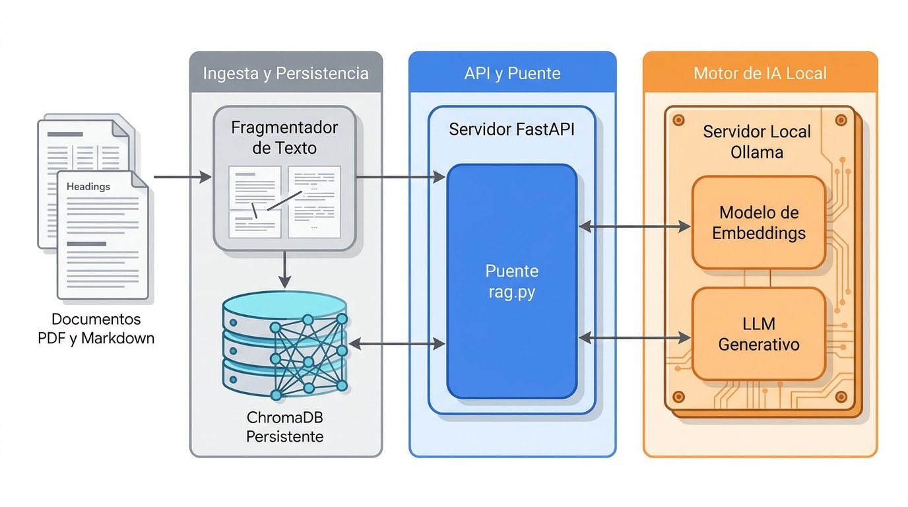

# AGENTS.md

Agent and contributor guide for `asistencia-cliente-local`: a 100% local
customer-support RAG service (FastAPI + ChromaDB + Ollama). No cloud, no
telemetry, no dotenv, no API keys.

Feature branch of record: `feat/rag-vectorial/jhon-hernandez`.

## What the service does

1. `api/ingest.py` reads `knowledge_base/**/*.md|pdf`, splits documents into
   chunks, embeds them with a local Ollama embedding model and persists the
   vectors in ChromaDB on disk (`chroma_db/`).
2. `api/rag.py` embeds the user question, retrieves the nearest chunks with
   cosine distance, applies the hybrid relevance gate and builds a grounded
   prompt.
3. `api/main.py` exposes the flow through FastAPI, including source/distance
   traceability and token streaming.
4. Ollama generates the answer with a small local chat model. The system
   prompt (`api/system_prompt.txt`) forces grounding and a fixed refusal.

## Local hardware budget (READ BEFORE CHOOSING MODELS)

This machine is CPU-only. Treat these numbers as hard constraints, not
suggestions:

| Resource | Value |
|---|---|
| CPU | AMD A12-9720P, 4 cores / 4 threads, 2.7 GHz max |
| RAM | 7.2 GB total, ~1.8–2.7 GB available while working |
| GPU | Radeon R7 integrated only; no CUDA, no usable ROCm |
| Disk free | ~27 GB |
| Python | 3.13 in `.venv` |
| Ollama | 0.40.13 at `http://localhost:11434` |

Consequences:

- One generation at a time (`LLM_CONCURRENCY_LIMIT=1`). Two concurrent 3B
  generations will swap.
- A full answer takes roughly 20–100 s on this CPU. Use the streaming
  endpoints for UX; do not lower timeouts below 300/400 s.
- Keep chunks small (800–900 chars) so the embedding context stays near the
  model's default and RAM stays flat.

### Approved models for this machine

| Role | Model | Disk | Why |
|---|---|---|---|
| Chat | `qwen2.5:3b-instruct-q4_K_M` | ~1.9 GB | Already installed; best Spanish/instruction balance that fits 7.2 GB |
| Embeddings | `nomic-embed-text` | ~274 MB | 768 dims, CPU-fast, prefixes handled in code |

Do **not** switch this machine to:

- `llama3.1` / `llama3.1:8b` (~4.7 GB) — does not fit alongside the OS.
- `bge-m3` (1.2 GB, 1024 dims) — better Spanish, but the extra RAM and CPU cost
  are not affordable here. Revisit only with 16 GB+ RAM or a GPU.
- `qwen3-embedding:0.6b` (639 MB) — better multilingual score, roughly 4x
  slower than nomic on 4 cores. Optional upgrade with more RAM.

Changing the embedding model invalidates the whole index: vectors from
different models live in different spaces. See “Changing the embedding model”.

## Architecture



```
knowledge_base/ ──ingest──> ChromaDB (cosine/HNSW, on disk)
                                   ▲
question ──embed(query)──> retrieve top_k ──hybrid gate──> prompt ──Ollama──> answer
```

## Repository map

| Path | Role |
|---|---|
| `api/config.py` | Single source of env config and repo-root path resolution |
| `api/embeddings.py` | Ollama embed client; nomic document/query prefixes; batching |
| `api/lexical.py` | Spanish lexical evidence used as the precision gate |
| `api/ingest.py` | Markdown/PDF chunking, deterministic IDs, prune, upsert, `--reset` |
| `api/rag.py` | `LocalVectorRAG`: retrieval, gate, prompt, ask/stream |
| `api/main.py` | FastAPI lifespan, semaphore, canonical + legacy endpoints |
| `api/system_prompt.txt` | Grounding rules and the exact refusal string |
| `knowledge_base/` | **Only** indexed corpus (`.md` and `.pdf`) |
| `docs/` | Meta-documentation (`MODELOS.md`, `BENCHMARK.md`, `EVALUACION.md`), not indexed |
| `scripts/ingest.sh` | Load `.env` and run `python -m api.ingest` |
| `scripts/smoke-test.sh` | End-to-end checks against a running API |
| `scripts/test-local.sh` | Ollama, compose, models, `compileall` checks |
| `chroma_db/` | Generated index; gitignored, never commit |

## Setup from zero

```bash
python3 -m venv .venv
.venv/bin/pip install -r api/requirements.txt
bash scripts/pull-models.sh          # chat + embedding models, once
bash scripts/ingest.sh               # builds chroma_db/, ~30-40 s here
set -a; source .env; set +a          # API does not load .env itself
.venv/bin/uvicorn api.main:app --port "${API_PORT:-8000}"
```

Windows PowerShell:

```powershell
python -m venv .venv; .\.venv\Scripts\Activate.ps1
pip install -r api/requirements.txt
ollama pull qwen2.5:3b-instruct-q4_K_M
ollama pull nomic-embed-text
python -m api.ingest
Get-Content .env | Where-Object { $_ -match '\S' -and -not $_.TrimStart().StartsWith('#') } | ForEach-Object { $k,$v = $_ -split '=', 2; Set-Item "env:$($k.Trim())" $v.Trim() }
uvicorn api.main:app --port $env:API_PORT
```

## Environment variables

| Variable | Default | Notes |
|---|---|---|
| `OLLAMA_BASE_URL` | `http://localhost:11434` | Ollama server |
| `OLLAMA_MODEL` | `qwen2.5:3b-instruct-q4_K_M` | Chat model |
| `OLLAMA_EMBED_MODEL` | `nomic-embed-text` | Embedding model; change requires re-index |
| `API_PORT` | `8000` | Uvicorn CLI flag only; not read by `api/main.py` |
| `RAG_TOP_K` | `4` | Retrieved chunks before the gate |
| `RAG_MAX_DISTANCE` | `0.50` | Cosine distance ceiling |
| `RAG_STRONG_DISTANCE` | `0.25` | Distance accepted without lexical evidence |
| `LLM_CONCURRENCY_LIMIT` | `1` | Keep at 1 on this hardware |
| `EMBED_BATCH_SIZE` | `32` | Ingestion batch size |
| `CHROMA_DB_PATH` | `./chroma_db` | Resolved against repo root |
| `CHROMA_COLLECTION` | `asistencia_cliente_kb` | Collection name |
| `KNOWLEDGE_BASE_DIR` | `./knowledge_base` | Indexed corpus root |
| `TEMPERATURE` | `0.2` | `0.0` makes refusal/answer behavior more deterministic |
| `OLLAMA_TIMEOUT` | `300` | Full answer timeout (seconds) |
| `OLLAMA_STREAM_TIMEOUT` | `400` | Stream timeout (seconds) |

`.env` is optional and never auto-loaded; export it before starting uvicorn.
`.env.example` documents the CPU-tuned values. Never commit `.env`.

## Ingestion contract

- Indexed files: `knowledge_base/**/*.md` and `knowledge_base/**/*.pdf`.
  Everything else is ignored; `docs/` is intentionally outside the corpus.
- Markdown: two-stage split preserving hierarchy. `#` → `categoria`,
  `##` → `seccion`, `###` → `pregunta`; then `RecursiveCharacterTextSplitter`
  at 800 chars with 150 overlap. Chunks under 40 chars are dropped.
- PDF: `pypdf` page by page, 900 chars with 180 overlap; metadata includes
  `page`.
- IDs: `{source}_chunk_{index}_{md5(content)[:8]}`. Re-running ingestion is
  idempotent; stale IDs for an edited source are deleted, and chunks whose
  source file was removed are pruned.
- `python -m api.ingest --reset` drops and recreates the collection.
- Metadata values are strings/integers only (Chroma constraint).

## Retrieval contract (do not simplify to one threshold)

Measured with the real FAQ: a single `max_distance` is unusable. Off-domain
questions score 0.32–0.45, overlapping on-domain 0.20–0.41. Therefore each
chunk is kept only when:

```
distance <= RAG_MAX_DISTANCE
AND (distance <= RAG_STRONG_DISTANCE OR lexical_evidence(query, chunk) > 0)
```

- Vector search supplies recall; `api/lexical.py` supplies precision.
- `nomic-embed-text` requires `search_document: ` on stored chunks and
  `search_query: ` on questions. `api/embeddings.py` owns this; never call
  Chroma with `query_texts` or attach a Chroma embedding function.
- Send embeddings explicitly (`upsert(embeddings=...)`,
  `query(query_embeddings=...)`) and use `hnsw:space=cosine`.
- Use `truncate=False` when embedding: silent truncation would index the wrong
  meaning.
- If you change documents, chunk sizes or the embedding model, re-measure the
  gate. The calibration table lives in `odd/tasks/rag-vectorial.md`.

## API contract

| Method | Path | Notes |
|---|---|---|
| `GET` | `/health` | `{status, model, embedding_model, kb_chunks}`; never calls Ollama |
| `POST` | `/api/v1/ask` | `{question, categoria?}` → `{answer, sources[{content, metadata, distance}]}` |
| `POST` | `/api/v1/ask/stream` | Same input; plain-text token stream |
| `POST` | `/api/v1/sync-kb` | Re-indexes in a worker thread; returns ingest stats |
| `POST` | `/v1/chat` | Legacy compatibility; `sources` is `list[str]` |
| `POST` | `/v1/chat/stream` | Legacy SSE: `sources` → `delta` → `[DONE]` |

`categoria` is an exact-match filter on the `#` heading metadata. An unknown
category returns no chunks and the assistant refuses.

## Operations

- Add or edit a document: put it under `knowledge_base/`, then
  `bash scripts/ingest.sh` (or `POST /api/v1/sync-kb`). A 3B answer is not
  affected, but ingestion takes ~30–40 s for this corpus.
- First run after cloning: ingest before querying. `/health` showing
  `kb_chunks: 0` means every answer will be the refusal.
- Changing the embedding model: update `OLLAMA_EMBED_MODEL`, run
  `python -m api.ingest --reset`, and re-measure the gate. Never mix spaces.
- Deleting `chroma_db/` is safe: it is a generated artifact.
- Do not run ingestion concurrently with a heavy query on this machine; both
  compete for the embedding/chat models and RAM.
- Chroma telemetry is disabled in both `ingest.py` and `rag.py`.

## Verification protocol

Run these before reporting the feature complete:

```bash
bash scripts/test-local.sh                 # Ollama + compose + models + compileall
bash scripts/ingest.sh                     # twice; same collection_count both times
.venv/bin/uvicorn api.main:app --port 8000 &
bash scripts/smoke-test.sh                 # health, on-domain, off-domain, stream
```

Expected: `/health` has `kb_chunks: 10` for the sample FAQ; the on-domain
question returns a non-empty answer and sources; the off-domain question
returns `sources: []` and the exact refusal; the stream returns text.

TDD exception: the repo has no pytest dependency or test suite. The runnable
checks are `compileall`, ingest idempotency and the end-to-end smoke test.
Adding pytest is welcome, but do not claim RED/GREEN evidence that was not
observed.

## Known limitations and pitfalls

- The 3B model occasionally over-refuses a paraphrase even when the correct
  chunk is in context (safe failure). Lower `TEMPERATURE` to `0.0` for more
  deterministic behavior, or use a larger chat model when hardware allows.
- PDF ingestion is implemented but this corpus has no PDF, so the real PDF
  path is not exercised end to end. Add a small PDF and re-run the smoke test
  before relying on it.
- `api/system_prompt.txt` is re-read on every request; context headers are
  deliberately placed at the END of each block (source labels first caused the
  3B model to echo the header instead of answering).
- The list of files is re-scanned on every ingestion; a full-collection
  `get(include=["metadatas"])` is used to prune deleted sources. Fine at this
  scale, revisit for thousands of chunks.
- No authentication. Bind to `127.0.0.1` unless the network is trusted.
- `categoria` is free-form metadata; there is no validation layer.

## Conventions and non-negotiables

- README is neutral Spanish; code, comments, docstrings and this file are
  English. No voseo or slang in artifacts.
- Keep the stack small: `fastapi`, `uvicorn`, `pydantic`, `httpx`, `chromadb`,
  `ollama`, `langchain-text-splitters`, `pypdf`. No dotenv, no vector DB
  service, no cloud calls.
- Never commit `.env`, `chroma_db/`, model files or generated caches.
- Do not change `docker-compose.yml` to a GPU variant on this machine; the
  current file is intentionally CPU-only.
- Keep the refusal string in `api/system_prompt.txt` exactly:
  `No tengo esa información en mi base local`.
- Prefer small, reviewable changes that keep tests, docs and behavior together.
