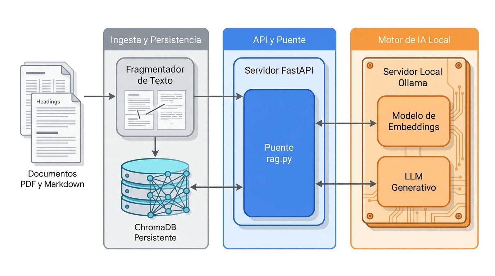

# Asistencia al cliente local

Servicio de atención al cliente con RAG vectorial 100 % local: FastAPI +
ChromaDB + Ollama. Sin nube, sin telemetría, sin costo por consulta y con los
datos siempre en el equipo.

El flujo es simple:

1. Los documentos de `knowledge_base/` se fragmentan y se indexan en ChromaDB.
2. La pregunta se convierte en un vector con `nomic-embed-text`.
3. Se recuperan los fragmentos más cercanos y se filtran con una compuerta
   híbrida (distancia + evidencia léxica).
4. El LLM local responde usando solo esos fragmentos y devuelve las fuentes.

## Arquitectura



```
knowledge_base/ ──ingesta──> ChromaDB persistente (cosine/HNSW)
                                      ▲
pregunta ──embedding──> top_k ──compuerta──> prompt ──Ollama──> respuesta
```

## Perfiles de hardware

| Perfil | Descripción | Modelos de chat | Embeddings |
|--------|-------------|-----------------|------------|
| Modesto (CPU-only) | Sin GPU dedicada; todo corre en CPU | 1B–3.8B en GGUF `Q4_K_M` | `nomic-embed-text` |
| Potente (NVIDIA) | GPU NVIDIA con CUDA | 7B–14B | `bge-m3` o `qwen3-embedding:0.6b` |

> Este repositorio está calibrado para el perfil modesto: 4 núcleos, 7.2 GB de
> RAM y sin CUDA/ROCm. Los modelos y umbrales concretos de esa máquina están
> documentados en `AGENTS.md`.

## Requerimientos

| Necesidad | Versión mínima | Para qué se usa |
|-----------|----------------|-----------------|
| Docker + Compose v2 (`docker compose`) | Docker 24+ | Opcional: levanta Ollama + Open WebUI. Sin Docker, instalar Ollama nativo |
| Python + venv + pip | Python 3.10+ | API RAG y CLI `scripts/dev.py` |
| Ollama CLI (`ollama`) | Última estable | Descarga los modelos una sola vez |
| Puertos libres | — | `3000` (Open WebUI), `8000` (API), `11434` (Ollama) |
| Disco | ~1 GB libre | Modelo de chat (~2 GB aparte) + embeddings (274 MB) + venv (~530 MB) + índice |

Dependencias de Python (`api/requirements.txt`): `fastapi`, `uvicorn`,
`pydantic`, `httpx`, `chromadb`, `ollama`, `langchain-text-splitters`, `pypdf`,
`python-dotenv`.

### Linux

- Docker Engine + plugin Compose, con el servicio en ejecución y el usuario en
  el grupo `docker` (o usar `sudo`).
- `python3`, `python3-venv`, `pip` y `git`.
- Verificar con: `docker --version`, `docker compose version`,
  `python3 --version`, `ollama --version`.

### Windows

- Windows 10/11 de 64 bits.
- Python 3.10+ desde `python.org` con la opción `Add to PATH` marcada; si el
  lanzador `python` no está disponible, usar `py -3`.
- Ollama Desktop para Windows, o descargar los modelos dentro del contenedor:
  `docker exec -it <contenedor-ollama> ollama pull qwen2.5:3b-instruct-q4_K_M`.
- Docker Desktop (backend WSL2) es opcional.

## Quickstart

Los mismos comandos funcionan en Linux, macOS y Windows:

```bash
# 1. Ollama + Open WebUI (CPU-only); omitir si ya hay Ollama nativo
docker compose up -d

# 2. Entorno virtual, dependencias y .env (una sola vez)
python scripts/dev.py setup

# 3. Modelos: chat + embeddings (una sola vez)
python scripts/dev.py models

# 4. Índice vectorial (una sola vez, o después de cambiar documentos)
python scripts/dev.py ingest

# 5. API (lee API_PORT desde .env)
python scripts/dev.py api
```

En otra terminal:

```bash
python scripts/dev.py smoke
```

> `scripts/dev.py` se reejecuta con el intérprete de `.venv` del repositorio,
> así que no hace falta activar el entorno virtual. Si `python` no está
> disponible, usar el lanzador equivalente: `python3` en Linux/macOS o `py -3`
> en Windows (por ejemplo, `python3 scripts/dev.py setup`).

Documentación interactiva: `http://localhost:8000/docs`.

## Scripts

| Comando | Propósito | Opciones |
|---------|-----------|----------|
| `python scripts/dev.py setup` | Crea `.venv`, instala `api/requirements.txt` y copia `.env.example` a `.env` si falta | — |
| `python scripts/dev.py models` | Descarga el modelo de chat y el de embeddings configurados | — |
| `python scripts/dev.py ingest` | Reconstruye o actualiza el índice vectorial | `--reset` (borra y recrea la colección) |
| `python scripts/dev.py api` | Inicia uvicorn en `API_PORT` | `--host`, `--port`, `--reload` |
| `python scripts/dev.py smoke` | Verifica una API en ejecución | `--url` (por defecto `API_URL` o `http://localhost:API_PORT`) |
| `python scripts/dev.py check` | Verifica Ollama, modelos, `compileall` y `docker compose config` si Docker está instalado | — |

Los argumentos adicionales se reenvían a `python -m api.ingest` en `ingest` y a
`uvicorn` en `api`.

## Uso sin Docker (Ollama nativo)

Sin Docker no hay Open WebUI en `http://localhost:3000`; la API en
`http://localhost:8000` funciona igual porque solo necesita
`http://localhost:11434`.

```bash
# 1. Instalar Ollama (una sola vez): https://ollama.com/download
# 2. Iniciar el servidor en otra terminal
ollama serve

# 3. Entorno, dependencias y modelos
python scripts/dev.py setup
python scripts/dev.py models

# 4. Índice y API RAG
python scripts/dev.py ingest
python scripts/dev.py api
```

> Open WebUI es un chat directo contra Ollama: no pasa por esta API ni usa la
> base vectorial. Para consultar el RAG, usar `/api/v1/ask`, el streaming o
> `http://localhost:8000/docs`.

## Base de conocimiento

- Solo se indexan `knowledge_base/**/*.md` y `knowledge_base/**/*.pdf`.
- Markdown: `#` se guarda como `categoria`, `##` como `seccion` y `###` como
  `pregunta`. Conviene mantener una pregunta por `##` para que cada fragmento
  sea autocontenido.
- PDF: se indexa página por página y la metadata incluye `page`.
- `docs/` contiene documentación meta (`MODELOS.md`, `BENCHMARK.md`,
  `EVALUACION.md`) y **no** se indexa.
- Después de agregar o editar documentos:

```bash
python scripts/dev.py ingest   # reconstruye/actualiza el índice
# o, con la API levantada:
curl -X POST localhost:8000/api/v1/sync-kb
```

La ingesta es idempotente: volver a ejecutarla no duplica fragmentos y elimina
los que ya no corresponden a ningún archivo.

## Variables de entorno

`api/config.py` carga `.env` desde la raíz del repositorio con `python-dotenv`
al importarse. Las variables ya exportadas en el entorno tienen prioridad sobre
el archivo; si `.env` no existe, se usan los valores por defecto. `API_PORT` lo
leen `python scripts/dev.py api` y `python scripts/dev.py smoke`, no
`api/main.py`.

| Variable | Valor por defecto | Descripción |
|----------|-------------------|-------------|
| `OLLAMA_BASE_URL` | `http://localhost:11434` | URL del servidor Ollama |
| `OLLAMA_MODEL` | `qwen2.5:3b-instruct-q4_K_M` | Modelo de chat |
| `OLLAMA_EMBED_MODEL` | `nomic-embed-text` | Modelo de embeddings; cambiarlo exige reindexar |
| `API_PORT` | `8000` | Puerto por defecto de `scripts/dev.py api` y `smoke` |
| `RAG_TOP_K` | `4` | Fragmentos recuperados antes de la compuerta |
| `RAG_MAX_DISTANCE` | `0.50` | Distancia de coseno máxima |
| `RAG_STRONG_DISTANCE` | `0.25` | Distancia aceptada sin evidencia léxica |
| `LLM_CONCURRENCY_LIMIT` | `1` | Generaciones simultáneas; 1 en CPU-only |
| `EMBED_BATCH_SIZE` | `32` | Tamaño de lote de embeddings |
| `CHROMA_DB_PATH` | `./chroma_db` | Ruta del índice persistente |
| `CHROMA_COLLECTION` | `asistencia_cliente_kb` | Nombre de la colección |
| `KNOWLEDGE_BASE_DIR` | `./knowledge_base` | Corpus indexado |
| `TEMPERATURE` | `0.2` | Temperatura de generación (`0.0` = más determinista) |
| `OLLAMA_TIMEOUT` | `300` | Timeout de respuesta completa (segundos) |
| `OLLAMA_STREAM_TIMEOUT` | `400` | Timeout de streaming (segundos) |

Timeouts recomendados:

| Perfil | `OLLAMA_TIMEOUT` | `OLLAMA_STREAM_TIMEOUT` |
|--------|------------------|-------------------------|
| Modesto (CPU-only) | 300 | 400 |
| Potente (NVIDIA) | 60–120 | 120–180 |

## Endpoints de la API

| Método | Ruta | Descripción |
|--------|------|-------------|
| `GET` | `/health` | Estado, modelos y cantidad de fragmentos indexados |
| `POST` | `/api/v1/ask` | `{question, categoria?}` → `{answer, sources[{content, metadata, distance}]}` |
| `POST` | `/api/v1/ask/stream` | Misma entrada; respuesta token por token en texto plano |
| `POST` | `/api/v1/sync-kb` | Reindexa `knowledge_base/` en un hilo aparte |

`categoria` es un filtro exacto sobre la metadata del encabezado `#`. Una
categoría inexistente devuelve `sources: []` y la respuesta de rechazo.

Ejemplo de streaming:

```bash
curl -N -X POST localhost:8000/api/v1/ask/stream \
  -H 'Content-Type: application/json' \
  -d '{"question":"¿Hacen envíos a domicilio?"}'
```

## Modelos recomendados

### Perfil modesto (CPU-only)

- **Chat por defecto:** `qwen2.5:3b-instruct-q4_K_M` (~1.9 GB). Mejor
  equilibrio entre español, instrucciones y RAM en 3B.
- **Embeddings:** `nomic-embed-text` (~274 MB, 768 dimensiones). Requiere los
  prefijos `search_document:` y `search_query:`; el código ya los aplica.
- **Alternativa de chat:** `gemma3:1b` si el equipo necesita más velocidad.
- **No usar en 7 GB:** `llama3.1:8b` (~4.7 GB) no entra junto con el sistema;
  `bge-m3` (1.2 GB) es mejor en español pero compite por RAM y CPU.

### Perfil potente (NVIDIA)

- **Chat:** 7B–14B en `Q4_K_M` (`qwen2.5:7b`, `qwen2.5:14b`), según VRAM.
- **Embeddings:** `bge-m3` (1024 dimensiones, sin prefijos) o
  `qwen3-embedding:0.6b` (1024 dimensiones, mejor multilingüe).
- Al cambiar el modelo de embeddings hay que reindexar todo:
  `python scripts/dev.py ingest --reset`.

## Operación y diagnóstico

- **Primer arranque:** si `/health` devuelve `kb_chunks: 0`, falta ejecutar
  `python scripts/dev.py ingest`. Sin índice, todas las respuestas son el
  rechazo.
- **Respuestas lentas:** en CPU-only una respuesta completa tarda ~20–100 s.
  Usar `/api/v1/ask/stream` para ver los tokens mientras se generan.
- **Reindexar:** `python scripts/dev.py ingest`; tarda ~30–40 s para el corpus
  de ejemplo.
- **Cambiar el modelo de embeddings:** actualizar `OLLAMA_EMBED_MODEL`, ejecutar
  `python scripts/dev.py ingest --reset` y volver a medir la compuerta. Mezclar
  vectores de modelos distintos produce resultados inválidos.
- **Borrar el índice:** `chroma_db/` es un artefacto generado; se puede borrar
  y reconstruir sin riesgo.
- **PDF:** la ruta está implementada, pero el corpus de ejemplo no incluye PDF.
  Agregar uno pequeño y repetir el smoke test antes de confiar en ella.

## Verificación

```bash
python scripts/dev.py check       # Ollama, compose, modelos y compileall
python scripts/dev.py ingest      # ejecutar dos veces: mismo collection_count
python scripts/dev.py api         # en una terminal
python scripts/dev.py smoke       # en otra terminal, con la API en ejecución
```

Resultado esperado: `/health` con `kb_chunks: 10` para la FAQ de ejemplo; una
pregunta del dominio devuelve respuesta y fuentes; una pregunta fuera del
dominio devuelve `sources: []` y el texto exacto
`No tengo esa información en mi base local`.

## Docker

El `docker-compose.yml` es CPU-only (`docker compose up -d`). Para NVIDIA,
agregar `gpus: all` al servicio `ollama` en una copia local; no modificar el
archivo del repositorio:

```yaml
services:
  ollama:
    image: ollama/ollama
    gpus: all  # solo variante NVIDIA
```

## Privacidad

- Sin llamadas a servicios externos: solo `OLLAMA_BASE_URL`.
- Telemetría de Chroma deshabilitada en ingesta y consulta.
- Sin autenticación: enlazar a `127.0.0.1` salvo que la red sea confiable.
- No commitear `.env`, `chroma_db/`, modelos ni cachés generadas.
